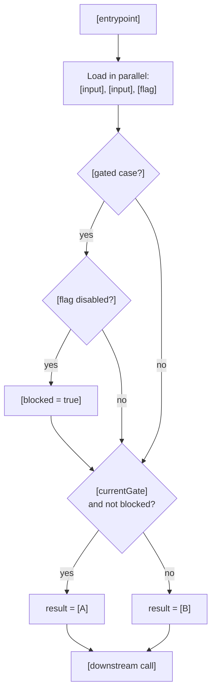
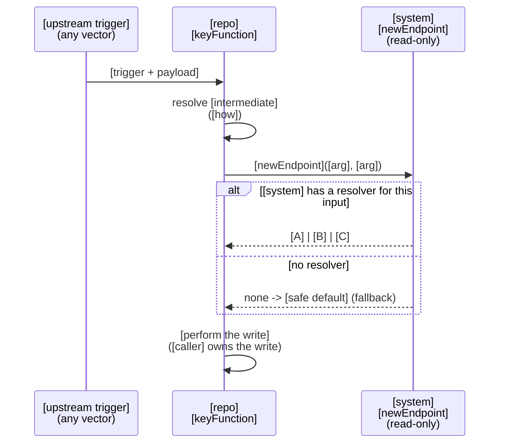
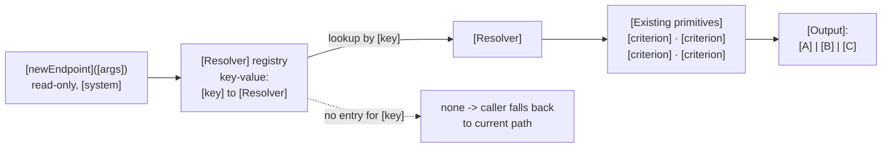
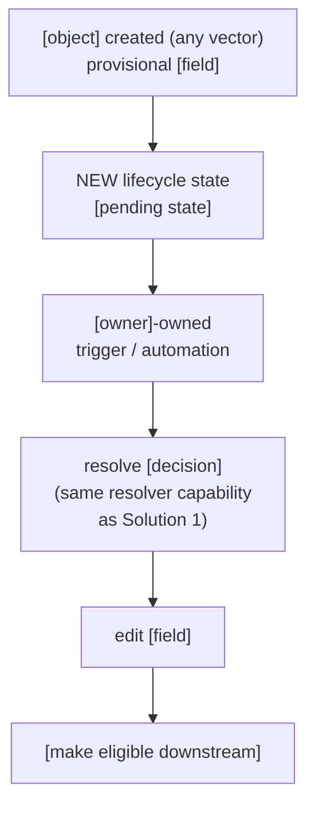
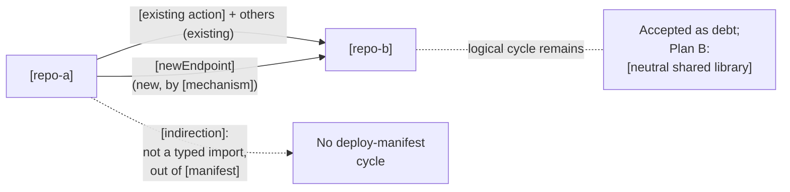

# ADR-NNNN - [Title: the capability, not the mechanism]

**Short name**: [internal nickname, e.g. 'Midpatch']

**Author**: [Name]
**Date**: [YYYY-MM-DD]
**Status**: [DRAFT | DECIDED | SUPERSEDED BY [ADR-NNNN](NNNN-title.md)]
**Repos in scope**: `[repo-a]` ([stack]), `[repo-b]` ([stack])
**Attendees:** [Name, Name, Name]

## Questions to answer by end of meeting

*One line per decision you need from the room. Fill the answer in live; the doc becomes the record of the decision.*

**[Does team X also plug into this solution?]**
[Yes / No / Deferred, one line of context]

**[Is the owning team comfortable with this being added to their service?]**
[Yes / No / Deferred]

**[Are we good to move forward with Solution N?]**
[Yes / No / Deferred]

## Problem Statement

*Two to four paragraphs. Where we've been and what changes now → the concrete gap, naming the existing thin/brittle mechanism and what it can't express → the anti-goal: what you are explicitly NOT going to build, and why the existing thing is worth reusing.*

[In (period) we did X. In (next period) we begin work on Y, which surfaces (problem).]

[Today, (decision) is made by (current mechanism). That mechanism has no notion of (capability 1), (capability 2), or (capability 3), all of which already exist as components in (existing system). It is not extensible for (scenario). Effectively, we need to solve the same problem as (existing system).]

[We do not want to build a second version of (existing system). It already owns a proven (library / abstraction). The goal is to leverage it at (new point), not to reimplement it.]

## Goal

*One sentence: the decision being made reusable, where it becomes reusable, what it reuses, and the safe default when it has no answer.*

[Make (system)'s (decision) reusable at **(new integration point)**, leveraging (system)'s existing (criteria / rollout controls), with a safe fallback to (default) when (system) has no opinion.]

## Callouts

*In-flight work or timing constraints that affect sequencing but not the approach. Link out.*

- [System] is currently undergoing [a refactor](link); this doesn't change the high-level approach, but we may want to hold final implementation until after.
- [Other component] is potentially also being refactored to [target].

## Background

*Establish the current system precisely enough that the reader can evaluate the proposals. Name the real function / file names. Point at the existing hack and say why it exists.*

[There are a few vectors for (thing) creation, but the majority of steady-state creation happens through (A) and (B).]

Figure: Current-state map: all entry points converging on the object

```mermaid
flowchart TB
  subgraph Automated["Automated / System"]
    A1["[vector]<br/>[entrypoint]"]
    A2["[vector]<br/>[entrypoint]"]
  end
  subgraph UserDriven["User / Agent Driven"]
    U1["[vector]<br/>[entrypoint]"]
  end
  A1 --> OBJ(([Object]))
  A2 --> OBJ
  U1 --> OBJ
```

[`keyFunction` is used for (purpose): it (step 1), resolves (step 2), and (step 3); there's a lot else going on, but those are the relevant bits. It is invoked both by (caller A) and (caller B). Today the (decision) for (case) is the thin `currentGate` check in `file.ts`. We ran into issues with (incident), so there is also a temporary gate on (thing), a partial motivation for this document.]

Figure: Current decision path, including temporary gates



## Proposed Solutions

### Solution 1: [Verb the thing] via [mechanism] [Recommended]

*Lead with the mechanism in one paragraph: what gets added, who calls it, what it returns, what happens when it has no answer. Then a sequence diagram with the happy path and the fallback. Then a named sub-paragraph for the internal abstraction, plus a diagram of it.*

[Add a new **read-only Query** to (system) that resolves (decision) for a known (input). `caller` calls it as an additional step in the existing flow: it passes (inputs), receives (output), and proceeds. If (system) has no resolver for that input, it returns no opinion, and today (caller) can fall back to the existing behavior ((current gate)) until we migrate all legacy paths. Eventually no decision would default to (safe default).]

Figure: Solution 1: call flow with fallback



**The [system]-side abstraction.** [The new endpoint holds a list of **(Resolvers)** as a key-value store of `key → Resolver`. A `Resolver` carries a list of (existing primitives) and uses them to determine (output) (`A | B | C`). This reuses (system)'s existing (primitives) and the (flag / sampling / rollout) functionality wrapped around them, without impacting (the existing first-order use case).]

Figure: Resolver registry and criteria composition



#### Pros

*Bold the claim, then one sentence of substantiation. Order by what the room cares about: lift, reuse, unblocked-today, safety.*

- **Lowest lift.** [One added call inside the existing flow; ownership is unchanged.]
- **Reuses [system]'s [components] and its [rollout controls].**
- **Works today across the [framework/version] boundary.** [An (old) caller can invoke a (new) endpoint by (mechanism); not gated on the in-flight (migration).]
- **Safe and incremental.** [Falls back to current behavior wherever there is no resolver; coverage grows one (unit) at a time. Replaces the brittle `currentGate` with real criteria.]

#### Cons / accepted trade-offs

*Be honest and specific. Name the coverage gap, the structural debt, the runtime cost, and the burden on the other team. These are accepted, not hidden.*

- **[Coverage gap.]** [The chosen integration point is not the only vector. If (alternate vector), this assignment can be missed.]
- **[Capability limit.]** [A read-only Query cannot write; (caller) still performs the write. If we do the (migration), we could move the write to (system).]
- **Requires a new endpoint in [system].** Added burden to that repo.
- **[Structural debt.]** [Introduces an `A → B` call on top of the existing `B → A` edge.]
- **Runtime cost.** [Adds an async call to (hot path).]

### Solution 2: [Alternative approach] [Not chosen]

*Describe it fairly and concretely; a strawman fools no one. Same diagram + Pros + Cons shape, then a Bottom line stating the deciding argument in two or three sentences.*

[Leave (existing thing) untouched; add (new mechanism) so that when any (object) is created, (owner) reads it, resolves (decision) using the same logic, edits (field), and only then makes it eligible for (downstream).]

Figure: Solution 2: event-driven post-creation resolution



#### Pros (why considered)

- **Fully decoupled.** Communicates through the [object], adding no direct `A → B` call (avoids [structural problem]).
- **Natural catch-all.** Applies to every [creation] vector automatically.

#### Cons (why not chosen)

- **Bigger lift.** [It still requires building the entire resolver capability from Solution 1, plus (new state) and (new infrastructure) on top. (Category of problem) is non-trivial to solve at this scale.]
- **Coherence.** [The decision would be made at (time A) for some cases and (time B) for others unless (existing case) is also reworked.]

**Bottom line:** [Solution 2 is a strict superset of Solution 1's work plus new machinery and new failure modes. Given that (chosen integration point) covers the overwhelming majority of (cases), the benefit of decoupling is diminished. If (alternate vector) becomes a popular entry point, adding (the Solution 1 mechanism) there is low lift.]

## Ownership

*Who contributes, who has final say, where the code lives, who does the first implementation. One short paragraph.*

["Bring your own rails": consuming teams contribute their own (criteria), but the (owning) team has final say over what is added and owns the (framework). The (new component) lives in (repo). (Implementing team) can own initial implementation with sign-off from (owning team).]

## Appendix

### [Known Limitation]: Limitation and Workarounds

*Take the ugliest trade-off from the recommended solution and give it its own section. State the current invariant, what the proposal breaks, diagram it, then Plan B with its real caveats.*

[Today the dependency graph is `A → B`; (B) never calls (A). Solution 1 introduces a `B → A` call ((the new component)).]

Figure: Dependency graph after Solution 1



**Future clean-up (Plan B).** [If the coupling becomes a pain point, (the engine) can be extracted into a shared library, making both sides depend on a neutral package (a clean DAG). Note this is (constraint)-only, so it cannot serve (legacy) until its migration completes; it is community-supported rather than an officially documented pattern; and it requires aligning (dependency) versions across repos. It is a deliberate fallback, not the default.]

### Glossary

*Define every system and domain term you leaned on, with the numbers that convey scale. This is what makes the doc readable outside the two teams.*

**[System A]** (`repo`, [stack]) owns [scope]. It [what it decides] using [its notable machinery] ([examples]). It [how it acts] by invoking [the other side's] `action`.

**[Domain concept]** is [what it is], [scale: N nodes across M groups and K edges]. It defines [what it means for the system].

**[System B]** (`repo`, [stack]) owns [scope].

**How they interact today** (dependency direction `A → B`): [who invokes whom, and the explicit statement that the reverse does not happen].
